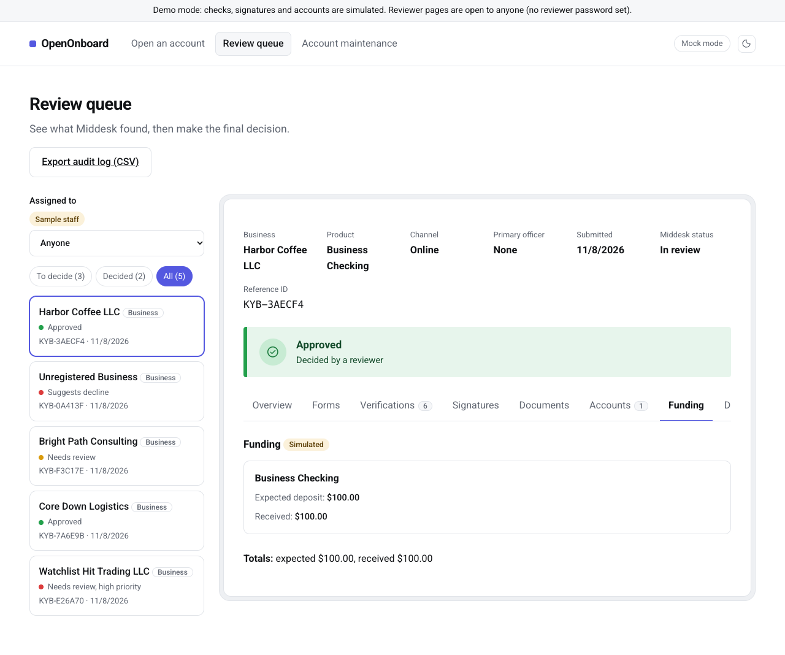

# OpenOnboard

A free, open-source app that helps banks, credit unions and fintechs open accounts for businesses.

[](https://github.com/Anhlam09/openonboard/actions)

## Who it's for

OpenOnboard is for **bankers and the teams who support them**. That includes community banks,
credit unions, fintechs, and people starting a new bank or fintech who need a way to open business accounts.

Buying an account-opening platform can be expensive and slow. OpenOnboard gives you a working
starting point today:

- **See it work in minutes.** Run the demo and walk through a full business application, no contracts or keys needed.
- **Shape it to your bank.** The approval rules, the form and the look are plain, readable code you can change.
- **Own it.** It's open source (MIT license): no vendor lock-in and no license fees. Services like Middesk charge their own fees.
- **Built with compliance in mind.** A person makes every decision, every step goes in the audit log,
  and full tax IDs are never stored.

It's a strong foundation, not a finished banking system. Before using it with real customers, your bank adds
its own policies, legal text and providers, and runs a security review.

## What it does

Before a bank opens an account for a business, it has to check that the business is real and
that the people behind it are who they say they are. This is called KYB ("know your business").
OpenOnboard handles that process from start to finish:

1. **The business applies.** One online form asks for the business details, its owners and any
   documents, such as formation papers or an EIN letter. The applicant reads the account terms and signs.
2. **The app checks the business.** It asks [Middesk](https://docs.middesk.com) to confirm the business
   is registered with the state, that its tax ID (EIN) matches IRS records, and that it isn't on a sanctions list.
3. **The app checks the owners.** Each owner gets an identity check.
4. **The app suggests a decision.** Based on the results, it marks the application **Looks good**,
   **Needs review** or **Likely decline**, and explains why in plain language.
5. **A person decides.** A bank reviewer sees everything on one screen and clicks **Approve** or **Decline**.
   The app never decides on its own.
6. **The account opens.** After approval, the account is created and waits for its first deposit.

A business owner can also open personal accounts in the same application.

The owner identity check, the signature and the account opening are simulated for now.
See [What's real and what's simulated](#whats-real-and-whats-simulated).

Every step is saved in an audit log that the bank can export for examiners.
For privacy, the app never stores a full tax ID, only the last 4 digits.

**Try it without any accounts or keys.** Without a Middesk key, the app runs in demo mode with realistic,
made-up results, so anyone can see how it works.

**[Try the live demo](https://anhlam09.github.io/openonboard/)**: it runs entirely in your browser, with nothing to install.



## Run it

**On your computer** (Python 3.11+):

```bash
git clone https://github.com/Anhlam09/openonboard.git
cd openonboard
python -m venv .venv
source .venv/bin/activate          # Windows: .venv\Scripts\activate
pip install -r requirements.txt
cp .env.example .env               # Windows: copy .env.example .env
uvicorn app.main:app --reload
```

Then open http://localhost:8000. API docs are at http://localhost:8000/docs.

**As a static web page (the live demo):**

The live demo is a plain web page on GitHub Pages, with no server. Your browser runs the app's own Python code
using [Pyodide](https://pyodide.org), always in demo mode. What you enter stays in your browser and is kept
between visits. Clear the site's data in your browser to start over. The first visit downloads about 9 MB and
takes a few seconds to start.

To build and preview it yourself:

```bash
python scripts/build_static.py          # writes the site to _site/
python -m http.server -d _site 8001     # then open http://localhost:8001
```

Every push to `main` rebuilds and publishes it (see [.github/workflows/pages.yml](.github/workflows/pages.yml)).
The in-browser pieces are in [web/](web/).

## Try it

1. Pick **Business accounts**, **Personal accounts** or **Business and personal**, press **Continue**, click a **Try sample data** button
   (try **Business owner: both** to open a company account and a personal one together),
   check **I have read and agree**, then **Submit application**.
2. In **Review queue**, click **Refresh results**.
3. Add a note, then **Approve account** or **Decline account**.

## What's real and what's simulated

| Part | Status |
|---|---|
| Application form, owners, document upload | Real |
| Review queue, decisions, audit log and CSV export | Real |
| Per-application JSON export (`GET /api/applications/{id}/export`: details, history, document names; no date of birth, SSN or file contents) | Real |
| Business checks (state registration, IRS EIN match, sanctions) | Real with a Middesk key, simulated without one |
| Identity checks on owners and on personal-account applicants | Simulated |
| Watchlist screen on personal-account applicants | Simulated |
| Business and personal accounts in one application (Middesk for the business only) | Real form and storage, simulated personal checks |
| Personal accounts (no Middesk; only the last 4 of each SSN is kept) | Real form and storage, simulated checks |
| Disclosures and signature | Simulated (sample text, typed name) |
| Product catalog (fees, rates, minimums) | Sample terms; the bank replaces them in `app/products.py` |
| Staff directory (assignees, primary officer, banker who helped in a branch) | Sample names in `app/staff.py`, not logins. Reviewer pages are protected by one shared password (`REVIEWER_PASSWORD`), which can't tell people apart |
| Account opening and first deposit, one account per chosen product | Simulated |
| Account maintenance (contact details, product switch, beneficiaries, signers, cards, checks, safe deposit box, tax ID, notes) | Real requests, approvals and stored changes; the core update after approval is Simulated. Tax IDs are kept as the last 4 digits only |

Staff assignment is only bookkeeping. The staff directory holds names, not logins. Set `REVIEWER_PASSWORD` to keep
the reviewer side behind a shared password; everyone shares it, so it can't tell
reviewers apart. Staff routes: `GET /api/staff`,
`POST /api/applications/{id}/assignees`, `DELETE /api/applications/{id}/assignees/{staff_id}` and
`PUT /api/applications/{id}/primary-officer`. Applications can also be opened in a branch (`channel: "in_branch"`
with `created_by`).

Maintenance routes: `GET /api/maintenance/kinds`, `POST` and `GET /api/applications/{id}/maintenance` and
`POST /api/maintenance/{id}/decision` (`approve` or `reject`, once). Requests need an approved application with an
open account, except notes, which complete at once. A person approves every change; nothing is applied on its own.

Simulated parts are labeled "Simulated" in the app, and a banner shows in demo mode. They only feed the
recommendation: a person makes every approve or decline, and accounts open only after approval.
Never use demo mode for real customers.

## Connect to Middesk

Middesk access goes through their sales team ([middesk.com/contact-sales](https://www.middesk.com/contact-sales)).
Add your sandbox key (starts with `mk_test_`) to `.env` as `MIDDESK_API_KEY`, and set `REVIEWER_PASSWORD`
(reviewer pages won't open without it once Middesk is connected), then restart the server.
Check the connection with `python -m app.check_middesk`. Middesk's API guide: [docs.middesk.com](https://docs.middesk.com).

## Tests

```bash
python -m pytest -q
```

## Independent project disclaimer

OpenOnboard is an independent, open-source educational prototype created to explore digital banking onboarding, KYB/KYC workflows, and technical integrations.

It is not affiliated with, sponsored by, or endorsed by any banking software provider or financial institution.

Demo verification, identity checks, account creation, and funding may be simulated. This software is not production-ready and must not be used to process real customer information without appropriate security, legal, and compliance review.

## License

[MIT](LICENSE). Not affiliated with Middesk. Not legal or compliance advice.
